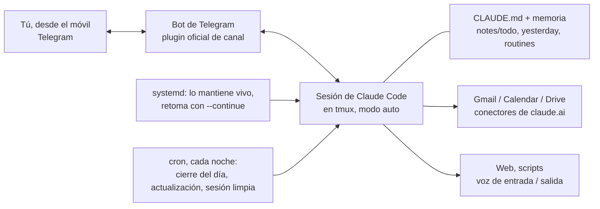

# claudia

**Un asistente personal con el que hablas por Telegram, hecho con [Claude Code](https://code.claude.com/docs) tal
cual, funcionando 24/7 con tu suscripción de Claude.** Sin frameworks de agentes y sin factura de API: una sesión de
Claude Code en una máquina aislada, el plugin oficial de Telegram, un `CLAUDE.md` que le da personalidad, unas notas
que sobreviven al reinicio diario y unos pocos scripts que lo mantienen vivo sin que nadie lo vigile.

Te lee el correo y te prepara borradores, te lleva la agenda y el Drive, apunta tus pendientes, te recuerda cosas, te
manda un resumen por la mañana, entiende tus notas de voz y puede contestarte con voz.

[Read in English](README.md)



> Proyecto no oficial, sin relación con Anthropic. Lee antes [¿Esto está permitido?](#esto-está-permitido).

## ¿Por qué no un framework de agentes?

Nuestro primer asistente fue [Hermes Agent](https://github.com/NousResearch/hermes-agent), y nos gustaba: está hecho
para ser una secretaria proactiva. Pero necesita un modelo detrás que se paga por uso, y el modelo barato que usábamos
(el de DeepSeek) se inventaba causas y daba vueltas con pasos que nadie pedía. La suscripción de Claude no se puede
conectar a agentes de terceros, pero sí cubre Claude Code. Y Claude Code con
[canales](https://code.claude.com/docs/en/channels) ya era casi un asistente; este repo es lo que faltaba. La
comparación sincera, incluido lo que Hermes sigue haciendo mejor, está en
[docs/comparison.md](docs/comparison.md) (en inglés).

## Qué necesitas

- Una **suscripción de Claude** (Pro o Max; Max si además programas con Claude, porque el asistente comparte tus
  límites de uso).
- Una **máquina Linux siempre encendida que puedas aislar**: una VM, un contenedor LXC, un mini PC, una VM barata en
  la nube. Sin modelos de voz locales, 2 núcleos, 2-4 GB de RAM y 10 GB de disco van sobrados. Mira
  [docs/isolation.md](docs/isolation.md).
- `tmux`, `jq`, `curl`, `git`, [Bun](https://bun.sh) (el plugin de Telegram funciona con él) y Claude Code.
- Un **bot de Telegram**: el token te lo da [@BotFather](https://t.me/BotFather).
- Opcional: Gmail / Google Calendar / Google Drive conectados en claude.ai (Ajustes → Conectores); una clave de
  [Groq](https://console.groq.com) para las notas de voz; una de [ElevenLabs](https://elevenlabs.io) para que hable.

## Empezar

```bash
# En la máquina del asistente, como root
adduser --disabled-password --gecos "" asistente        # o el nombre de usuario que quieras
apt install -y tmux jq curl git ffmpeg
git clone https://github.com/jonjunq/claudia && cd claudia
./install.sh asistente --name Claudia --owner Alex --language Spanish --timezone Europe/Madrid

# Como ese usuario: instala Claude Code y Bun, inicia sesión y conecta Telegram
su - asistente
curl -fsSL https://claude.ai/install.sh | bash
curl -fsSL https://bun.sh/install | bash
exec bash -l                             # para que coja el PATH nuevo
cd ~/assistant && claude                # entra con tu suscripción y, dentro de Claude Code:
#   /plugin install telegram@claude-plugins-official
#   /telegram:configure <token del bot>
#   sal y arranca una vez con: claude --channels plugin:telegram@claude-plugins-official
#   escríbele al bot y luego:  /telegram:access pair <código>  y  /telegram:access policy allowlist
nano ~/assistant/CLAUDE.md               # hazlo tuyo (escríbelo en castellano y hablará en castellano)
exit

# Como root: déjalo funcionando
systemctl enable --now assistant assistant-permission-watch
```

Y escríbele a tu bot. Paso a paso, con todos los tropiezos que tuvimos: [docs/setup.md](docs/setup.md).

## Qué trae

| Pieza | Qué hace |
|---|---|
| `templates/workspace/CLAUDE.md` | Personalidad y normas: respuestas para móvil, proactividad, qué hace solo y qué te pregunta antes, disciplina de memoria |
| `notes/todo.md`, `yesterday.md`, `routines.md` | La libreta que lleva de un día a otro, importada en cada conversación |
| `bin/start.sh` + `assistant.service` | Ejecuta Claude Code en tmux y lo recupera con `--continue` si se cierra |
| `assistant-daily-restart` + cron | Cada noche: le pide que guarde el día, actualiza Claude Code y empieza una conversación limpia |
| `settings.json` | Modo auto y una lista de permisos: leer y preparar borradores lo hace solo; enviar y borrar te lo pregunta por Telegram |
| `bin/statusline.sh` | Guarda el contexto y el uso del plan para que pueda responder a `/usage` desde Telegram |
| `bin/clear-context.sh` | `/clear` desde Telegram: conversación nueva a media jornada, después de apuntar lo pendiente |
| `bin/permission-watch.sh` | Te avisa por Telegram cuando se queda parado en un aviso de permiso de su terminal |
| `bin/transcribe.sh`, `bin/speak.sh` | Notas de voz de entrada (Whisper en Groq, con respaldo local) y de salida (ElevenLabs) |

## Documentación (en inglés)

- [Instalación](docs/setup.md): máquina, usuario, Claude Code, plugin de Telegram, servicio, primer arranque.
- [Personalidad y memoria](docs/personality-and-memory.md): cómo escribir el `CLAUDE.md`, las notas y la memoria.
- [Permisos](docs/permissions.md): modo auto, la lista de permisos y por qué no `bypassPermissions`.
- [Ciclo diario, rutinas y comandos](docs/daily-cycle.md): cierre del día, resumen matutino, `/usage`, `/clear`.
- [Voz](docs/voice.md): notas de voz, respuestas habladas y una llamada experimental por Discord.
- [Aislamiento](docs/isolation.md): dónde ejecutarlo y cómo cerrarlo.
- [Problemas frecuentes](docs/troubleshooting.md): los que nos encontramos de verdad.
- [Comparación](docs/comparison.md): Hermes Agent, un Proyecto de claude.ai y esto.

## ¿Esto está permitido?

No somos abogados y las condiciones pueden cambiar: lee tú mismo la página de
[Legal and compliance](https://code.claude.com/docs/en/legal-and-compliance) de Anthropic y sus
[Consumer Terms](https://www.anthropic.com/legal/consumer-terms). Lo que hace este montaje: **tú** inicias sesión en
Claude Code **sin modificar** con **tu propia** suscripción, mediante el login de Anthropic, y el asistente trabaja
**solo para ti** (la lista de Telegram solo deja entrar a tu cuenta). Esa página dice que el login con suscripción
está pensado para el "uso ordinario de Claude Code", que los límites anunciados de los planes "suponen un uso
ordinario e individual", y que terceros no pueden enrutar peticiones a través de credenciales Free/Pro/Max en nombre
de sus usuarios. Así que no lo conviertas en un bot para otras personas, en un asistente familiar compartido con una
sola suscripción ni en un servicio. Para eso, usa una clave de API con las condiciones comerciales.

## Créditos

Hecho con Claude Code sobre los [canales](https://code.claude.com/docs/en/channels) oficiales y el plugin de
Telegram de [claude-plugins-official](https://github.com/anthropics/claude-plugins-official). Lo de "una sola pregunta
con tu apuesta" para encargos poco definidos viene de la idea `interview-me` de
[addyosmani/agent-skills](https://github.com/addyosmani/agent-skills) (MIT); las normas de "Cuando tocas código" están
adaptadas de [Ponytail](https://github.com/DietrichGebert/ponytail) (MIT). Proyecto hermano:
[loop-kit](https://github.com/jonjunq/loop-kit), un bucle de construcción autónomo para Claude Code.

Licencia MIT, ver [LICENSE](LICENSE).
