# claudia

**A personal assistant you talk to on Telegram, built from plain [Claude Code](https://code.claude.com/docs) running
24/7 on your Claude subscription.** No agent framework and no API bill: one Claude Code session on a machine of
yours, the official Telegram channel plugin, a `CLAUDE.md` that gives it a personality, notes that survive a daily
restart, and a handful of small scripts that keep it alive unattended.

It reads and drafts your email, manages your calendar and Drive, keeps your to-do list, reminds you of things,
sends a morning summary, transcribes your voice notes and can answer with its own voice. With the optional
[n8n](docs/n8n.md) kit it hears about new email within seconds and sets up alerts for you that cost no tokens.

[Leer en castellano](README.es.md)

<p align="center">
  <a href="https://jonjunq.github.io/claudia/diagrams/how-it-works.html">
  <picture>
    <source media="(prefers-color-scheme: dark)" srcset="docs/diagrams/how-it-works-dark.svg">
    
  </picture>
  </a>
</p>

<sub>Interactive version (zoom, light/dark, trace a path): [open it in your browser](https://jonjunq.github.io/claudia/diagrams/how-it-works.html). Drawn with [Archify](https://github.com/tt-a1i/archify).</sub>

> Unofficial project, not affiliated with or endorsed by Anthropic. Read [Is this allowed?](#is-this-allowed) first.

## Why not an agent framework?

We ran [Hermes Agent](https://github.com/NousResearch/hermes-agent) as our assistant first, and liked it: it is
built to be a proactive secretary. But it needs a model behind it paid per token, and the cheap model we used
(DeepSeek's) made up causes and wandered through extra steps. A Claude subscription cannot be plugged into
third-party agents, but it does cover Claude Code. Claude Code with
[channels](https://code.claude.com/docs/en/channels) turned out to be most of an assistant already; this repo is
the rest. The honest comparison, including what Hermes still does better, is in
[docs/comparison.md](docs/comparison.md).

## What you need

- A **Claude subscription** (Pro or Max; Max if you also code with Claude, because the assistant shares your usage
  limits).
- An **always-on Linux machine**: a VM, an LXC container, a mini PC, a home server, a cheap cloud VM. 2 cores,
  2-4 GB of RAM and 10 GB of disk are plenty without local voice models. How isolated it is, is up to you:
  [Run it your way](#run-it-your-way).
- `tmux`, `jq`, `curl`, `git`, [Bun](https://bun.sh) (the Telegram plugin runs on it) and Claude Code.
- A **Telegram bot** token from [@BotFather](https://t.me/BotFather).
- Optional: Gmail / Google Calendar / Google Drive connected in claude.ai (Settings → Connectors); a
  [Groq](https://console.groq.com) key for voice notes; an [ElevenLabs](https://elevenlabs.io) key for spoken replies.

## Run it your way

This is open source, and there is no single right way to deploy it. We run ours as a normal user in its own
container, with the network fenced off and the admin installing system services, because it reads untrusted email
all day. You might prefer it as a user on the home server you already have, on a cloud VM, or as **root on a machine
that is entirely its own**, so it can install and look after everything itself (n8n included) and you never have to
step in. All of these work with the same files. The trade-off (more reach = more useful = more at stake if it is
fooled or makes a mistake) and what each option protects are in [docs/isolation.md](docs/isolation.md). Take what
fits, change the rest.

## Quick start

```bash
# On the assistant's machine, as root
adduser --disabled-password --gecos "" assistant        # or any user name
apt install -y tmux jq curl git ffmpeg
git clone https://github.com/jonjunq/claudia && cd claudia
./install.sh assistant --name Claudia --owner Alex --language English --timezone Europe/London

# As that user: install Claude Code + Bun, log in, connect Telegram
su - assistant
curl -fsSL https://claude.ai/install.sh | bash
curl -fsSL https://bun.sh/install | bash
exec bash -l                             # pick up the new PATH
cd ~/assistant && claude                # log in with your subscription, then inside Claude Code:
#   /plugin install telegram@claude-plugins-official
#   /telegram:configure <bot token>
#   exit, and start once with: claude --channels plugin:telegram@claude-plugins-official
#   message your bot, then:  /telegram:access pair <code>  and  /telegram:access policy allowlist
nano ~/assistant/CLAUDE.md               # make it yours
exit

# As root: run it for good
systemctl enable --now assistant assistant-permission-watch assistant-history.timer
```

Then write to your bot. Step by step, with every gotcha we hit: [docs/setup.md](docs/setup.md).

## What's new

The latest changes (full list in [CHANGELOG.md](CHANGELOG.md)):

- **Smaller context** (not yet in a release; [docs/memory.md](docs/memory.md#keeping-the-context-small)): the
  conversation compacts at 300k tokens instead of near 1M, the to-do list loaded into every conversation stays short,
  the nightly review prunes skills instead of only adding, and `templates/tools/token-usage.py` shows where your
  tokens and context go.
- **Alerts that cost no tokens, with n8n** ([docs/n8n.md](docs/n8n.md)): an installer that hardens n8n, workflow
  templates (new email → wake the assistant; watch a page → tell you, and switch itself off when done), updates with
  backup and automatic rollback, and the assistant building workflows itself through n8n's MCP server.
- **Wake-up instead of Monitors** ([docs/wakeup.md](docs/wakeup.md)): a small daemon that types one-line notices
  into the session only when a watched log or n8n has something. It replaced a Monitor that cost ~48 empty turns a
  day.
- **Payments are hard-blocked** in `settings.json` (`autoMode.hard_deny`), because "never payments" inside an allow
  rule blocks nothing.
- **Writes for the phone**: Telegram rich messages with a title, emoji signposts, a quote for the main idea and
  numbered options to answer with a number ([an example](docs/telegram-extras.md#writing-for-the-phone)).
- **Approve from Telegram what the classifier blocks**, one time, for that exact call.
- **Memory tools**: `recall` over old conversations, a nightly review of skills and memory, and a git history to
  undo it.
- **Run it your way**: the docs no longer assume an isolated container; they compare the options.
- Fixes: a phantom "⏳ Working" after turns without tools, and the nightly jobs under cron.

## What's in the box

The pieces, grouped by what they are for. Everything except the core is optional.

**Core**

| Piece | What it does |
|---|---|
| `templates/workspace/CLAUDE.md` | Personality and rules: phone-sized answers, quality first, proactive, what it may do alone vs. ask first, memory discipline |
| `notes/todo.md`, `yesterday.md`, `routines.md` | The notebook it carries across days, imported into every conversation |
| `bin/start.sh` + `assistant.service` | Runs Claude Code in tmux and brings it back with `--continue` if it exits |
| `assistant-daily-restart` + cron | Every night: asks it to save the day, updates Claude Code, starts a fresh conversation |
| `settings.json` | Auto mode, plus an allowlist: reads and drafts run alone, sending and deleting ask you on Telegram |
| `bin/statusline.sh` | Saves context and plan usage so it can answer `/usage` from Telegram |
| `autoMode.hard_deny` in `settings.json` | Payments and money are blocked outright, whatever anyone asks |
| `bin/clear-context.sh` | `/clear` from Telegram: fresh conversation mid-day, after saving what's pending |
| `bin/permission-watch.sh` | Tells you on Telegram when it is stuck on a prompt in its terminal, or switches model after a safeguard flag |

**Telegram and memory**

| Piece | What it does |
|---|---|
| `templates/telegram/` + hooks in `settings.json` | "⏳ Working" message while it works, quoted messages reach it, permission requests with Allow / Deny buttons, one-time approval of what the classifier blocked, rich messages (headings, tables) with `send-rich.py` |
| `templates/memory/` + `recall` skill | Searches old conversations (`recall`), reviews skills and memory every night, keeps a git history to undo |

**Reacting to the world without spending tokens**

| Piece | What it does |
|---|---|
| `templates/wakeup/` (`assistant-wakeup`) | Types a one-line notice into the session only when a watched log or n8n has something for it; batches bursts, waits out permission dialogs, never goes through Telegram |
| `templates/n8n/` (`install-n8n.sh`, `n8n-admin`, workflows) | Installs n8n hardened, imports and publishes workflows from the shell, updates it with backup and rollback; templates for new email → assistant and page watch → you |

**Extras**

| Piece | What it does |
|---|---|
| `bin/transcribe.sh`, `bin/speak.sh` | Voice notes in (Groq Whisper, local fallback) and out (ElevenLabs) |
| `.claude/skills/browser` | Uses websites through agent-browser instead of improvised scripts |
| `templates/tools/vet-skill.sh` | Scans a third-party skill with SkillSpector before you install it |

## Documentation

- [Setup](docs/setup.md): machine, user, Claude Code, Telegram plugin, service, first run.
- [Personality and memory](docs/personality-and-memory.md): writing `CLAUDE.md`, the notes, the memory.
- [Permissions](docs/permissions.md): auto mode, the allowlist, why not `bypassPermissions`, and teaching the
  classifier which devices and services are yours.
- [Daily cycle, routines and commands](docs/daily-cycle.md): end of day, morning summary, `/usage`, `/clear`.
- [Recall, nightly review and history](docs/memory.md): searching old conversations, improving skills and memory
  every night, and undoing it, with what it costs.
- [Telegram extras](docs/telegram-extras.md): a live "working" status, quoted messages, approving permissions with buttons and rich messages with tables.
- [Browser](docs/browser.md): agent-browser for websites without an API, set up in a container, with measurements.
- [Voice](docs/voice.md): voice notes, spoken replies and an experimental Discord voice call.
- [Run it your way](docs/isolation.md): where to run it (its own container, a user, root on its own machine, a cloud
  VM), what each option risks, and how to fence it if you want to.
- [Wake-up](docs/wakeup.md): reacting to logs and n8n with one-line notices instead of Monitors.
- [n8n](docs/n8n.md): alerts and automations that cost no tokens, built by the assistant itself, kept up to date.
- [Eyes on your server, no hands](docs/homelab-read-access.md): read-only access to Proxmox, backups and dashboards, safely.
- [Vetting skills](docs/vetting-skills.md): checking third-party skills before installing them (SkillSpector, per skill).
- [Troubleshooting](docs/troubleshooting.md): the real problems we hit.
- [Comparison](docs/comparison.md): Hermes Agent, a claude.ai Project, and this.

## Is this allowed?

We are not lawyers, and the terms can change: read Anthropic's
[Legal and compliance](https://code.claude.com/docs/en/legal-and-compliance) page and the
[Consumer Terms](https://www.anthropic.com/legal/consumer-terms) yourself. What this setup does: **you** sign in to
the **unmodified** Claude Code binary with **your own** subscription, through Anthropic's own login, and the
assistant works for **you alone** (the Telegram allowlist only lets your account in). That page says subscription
OAuth "is designed to support ordinary use of Claude Code", that advertised plan limits "assume ordinary,
individual usage", and that third parties may not route requests through Free/Pro/Max credentials on behalf of
their users. So do not turn this into a bot for other people, a shared family assistant on one subscription, or a
service. If you need that, use an API key under the Commercial Terms.

## Credits

Built with Claude Code on the official [channels](https://code.claude.com/docs/en/channels) and
[claude-plugins-official](https://github.com/anthropics/claude-plugins-official) Telegram plugin. "One question with
your best guess" for vague requests comes from the `interview-me` idea in
[addyosmani/agent-skills](https://github.com/addyosmani/agent-skills) (MIT); the "When you touch code" rules are
adapted from [Ponytail](https://github.com/DietrichGebert/ponytail) (MIT). Sibling project:
[loop-kit](https://github.com/jonjunq/loop-kit), an autonomous build loop for Claude Code.

MIT license, see [LICENSE](LICENSE).
